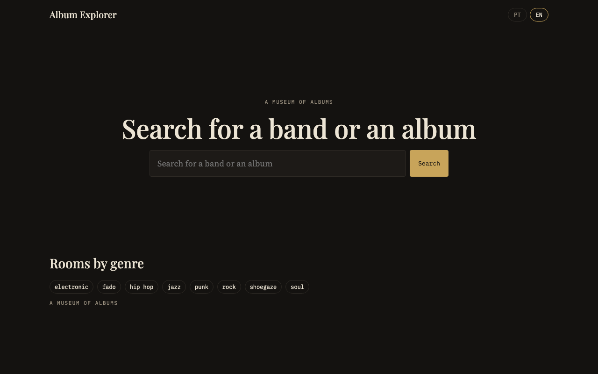
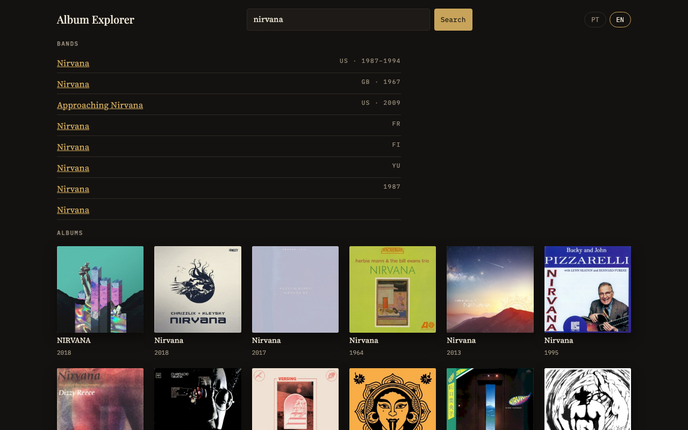
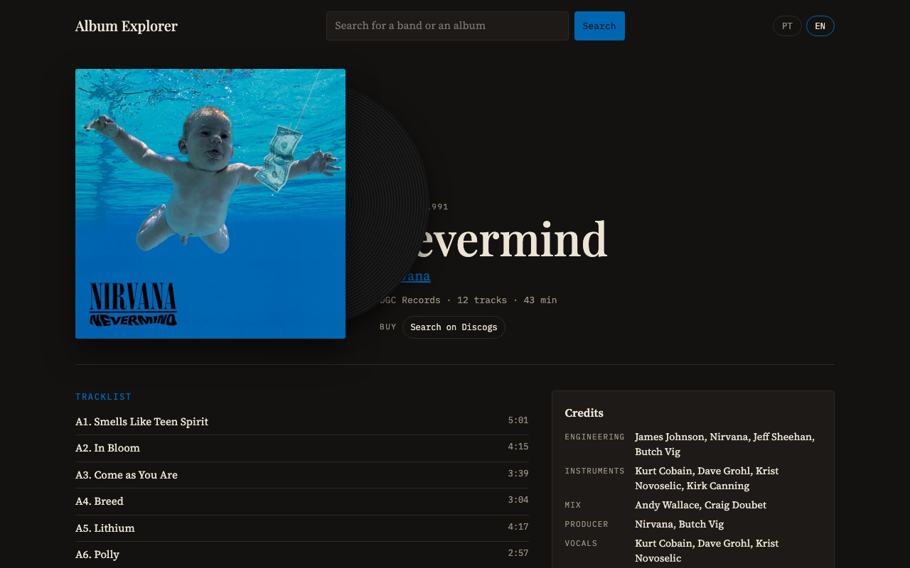
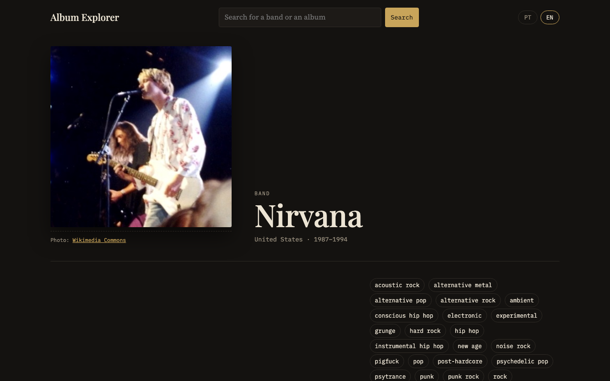

# Album Explorer

A bilingual (Portuguese / English) **museum of albums**. You arrive with the records you already love, look one up, and get to know it properly: how it was made, by whom, and what story it carries. Every album page is laid out like a museum placard: a vinyl sleeve, the tracklist by side, liner notes, quotes, credits, awards, and where to listen or buy, with the source of each piece shown right next to it.

> **Live demo:** coming soon.

This is phase 1 of a longer project, built as a portfolio demo: a real, working site whose architecture is meant to survive real users (caching, isolated data sources, rate limiting, background work, two languages), not a mock-up.

## Screenshots

| Home | Search |
|---|---|
|  |  |

| Album page | Band page |
|---|---|
|  |  |

Genre rooms (albums of a genre by decade) need a Last.fm API key to be populated, so there is no screenshot of one here.

## What it does

- **Search** with instant local suggestions and full MusicBrainz results.
- **Album page**: vinyl sleeve with sides, liner notes, notable quotes, credits (producer, engineers, musicians, studio), awards, other editions, and links to listen or buy.
- **Band page**: members and instruments by period, discography, story, quotes and awards.
- **Genre rooms**: a genre browsed decade by decade, ordered by popularity.
- **Any album works**: pages for albums nobody curated are built on demand. The core data appears first; the richer sections fill in as background jobs finish.

## Architecture

```
 browser ──► Django views ──► catalog/services ──► sources/* ──► MusicBrainz, Cover Art Archive,
              (server-rendered,   (import, stories,      │         Wikipedia, Wikiquote, Wikidata,
               htmx for sections)  quotes, links…)       │         Last.fm, Discogs
                     │                    │              └─ cache + rate limiter + retries
                     ▼                    ▼
                 PostgreSQL ◄──── background worker (django.tasks, DB-backed queue)
```

- **Sources layer** (`sources/`): one small module per external service, the only code that talks to the network. Responses go through an HTTP cache and a shared **rate limiter** that honours each service's rules (MusicBrainz: one request per second, with a proper User-Agent), and gives foreground requests priority over background ones. Failures raise typed errors (`SourceUnavailable`, `SourceNotFound`) so a missing source degrades a page instead of breaking it.
- **Background enrichment**: opening an album imports the core record (MusicBrainz and Cover Art Archive) synchronously, then enqueues a task that adds stories, quotes, awards, editions and links. The page loads the enriched sections with htmx when ready. The queue is database-backed (Django 6 `django.tasks` + `django-tasks-db`), so there is no Redis to run. Data goes stale after a while and is refreshed the next time someone visits.
- **Story fallback chain**: the liner notes come from the Wikipedia article in the reader's language, then the Last.fm wiki, and finally a fact sheet generated from the stored data ("Recorded in 1991 at Sound City, produced by Butch Vig…"). The page always has something true to say and always names where it came from.
- **Locked fields**: corrections made in the Django admin lock the edited fields, so later refreshes from the sources never overwrite human fixes. Rows created by hand are marked as manual and left alone.
- **Phase 2 ready**: credits, places and artist influences are already stored, so "similar albums, and why" will read data that exists rather than require a remodel.

Stack: Python 3.14, Django 6, htmx, PostgreSQL in production (SQLite locally), WhiteNoise, gunicorn.

## Data sources and licences

| Data | Source | Licence |
|---|---|---|
| Artists, albums, editions, tracks, credits, members | [MusicBrainz](https://musicbrainz.org) | CC0 (core data) |
| Covers | [Cover Art Archive](https://coverartarchive.org) | Per image, as shown by the archive |
| Album and band stories, quotes | [Wikipedia](https://wikipedia.org), [Wikiquote](https://wikiquote.org) | CC BY-SA |
| Awards, photos, influences, cross-source links | [Wikidata](https://wikidata.org) (and Wikimedia Commons for photos) | CC0 (Commons images: per image) |
| Story fallback, popularity | [Last.fm](https://www.last.fm) | Wiki text CC BY-SA; API terms apply |
| Release notes, labels, styles, marketplace search | [Discogs](https://www.discogs.com) | API terms apply |

**The "always show the source" rule:** every story, quote, award and image is stored with its source URL and licence, and the page displays them next to the content. Nothing is shown without attribution, and generated text is labelled as generated.

## Running it locally

Requires Python 3.14.

```bash
python3.14 -m venv .venv
source .venv/bin/activate
pip install -r requirements-dev.txt

cp .env.example .env        # keep DEBUG=1; add LASTFM_API_KEY / DISCOGS_TOKEN if you have them
python manage.py migrate
python manage.py seed       # genres + curated albums (takes minutes: it respects rate limits)
python manage.py createsuperuser   # optional, for /admin/
python manage.py runserver
```

In a second terminal, start the background worker so enrichment runs (without it, pages show only the core data):

```bash
python manage.py db_worker
```

`seed` is safe to re-run. `--skip-albums` and `--skip-rooms` narrow it. Without `LASTFM_API_KEY`, genre descriptions and rooms are skipped.

### Configuration

All configuration is by environment variable; see [`.env.example`](.env.example). `DEBUG` is off by default, and with it off the app refuses to start without `SECRET_KEY`.

## Deploying

Any host that runs a web process and a worker against PostgreSQL will do. The [`Procfile`](Procfile) declares them:

```
release: python manage.py migrate --noinput
web:     gunicorn config.wsgi --log-file -
worker:  python manage.py db_worker
```

Set `SECRET_KEY`, `DATABASE_URL`, `ALLOWED_HOSTS` and `CSRF_TRUSTED_ORIGINS` (plus the optional API keys and `CONTACT_URL`). On the build step run `python manage.py collectstatic --noinput` (WhiteNoise serves the files with hashed names). On first deploy, after `migrate`, run `python manage.py seed`. If your host has no release phase, run `migrate` as part of the deploy command.

## Tests

```bash
pytest
```

The suite (270+ tests) runs offline: external services are replaced by recorded fixtures (`respx`), the task queue is swapped for an immediate backend, and the clock is faked where rate limiting matters. CI (`.github/workflows/ci.yml`) also checks that no migration is missing and that `check --deploy --fail-level WARNING` passes with production settings.

## Roadmap

1. **Search and the album page with its story** (this repository).
2. Track ranking, sales charts and critics' lists; similar albums, always with the reason for the link (same producer, same scene, influence).
3. Concerts.
4. Reviews, ratings and user contributions, including stories and quotes.
5. Accounts, personal lists and a full public launch.

## Built with Claude Code

The design, implementation, tests and this README were produced with [Claude Code](https://claude.com/claude-code), working task by task from a written spec and plan, with test-driven development and a review pass on every step.
